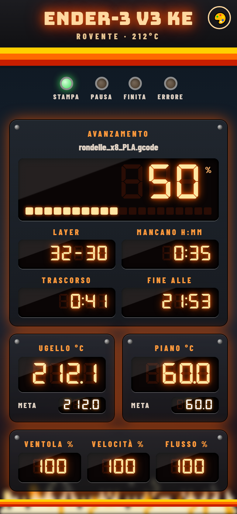
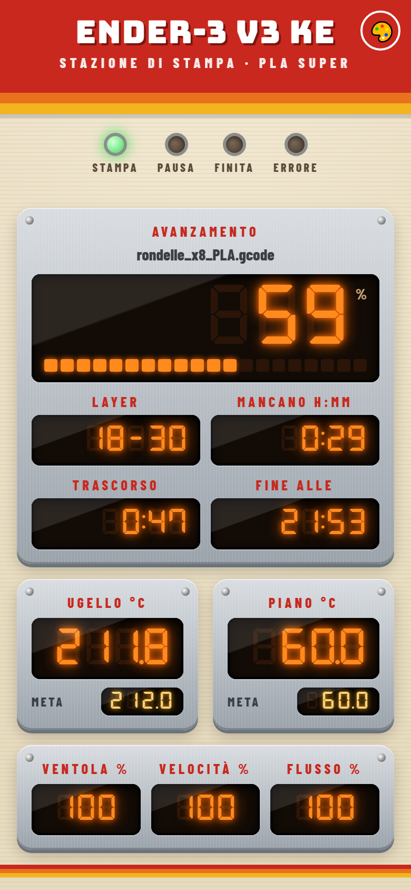
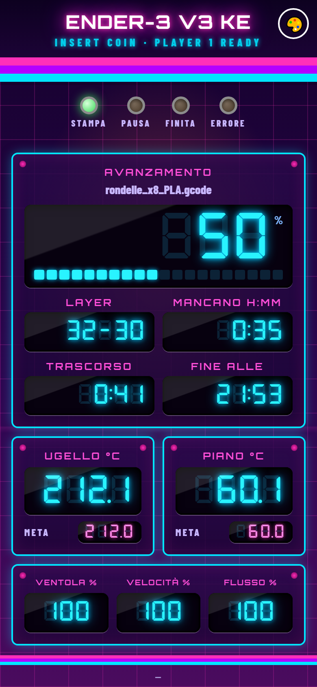
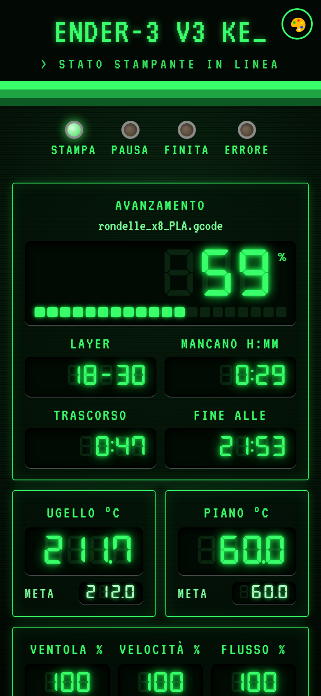
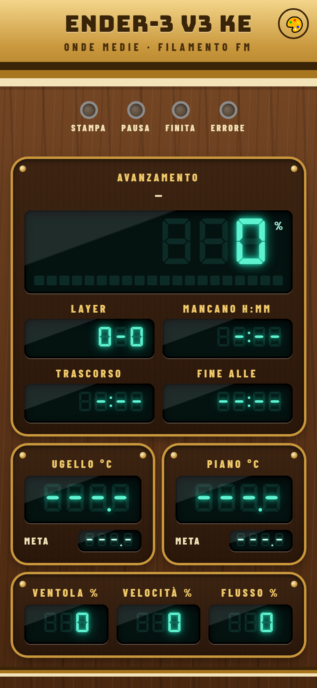
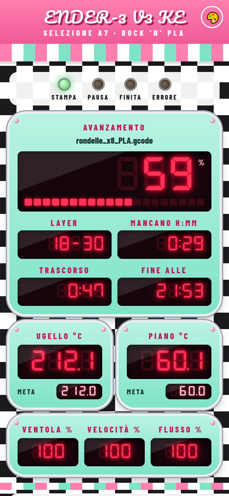
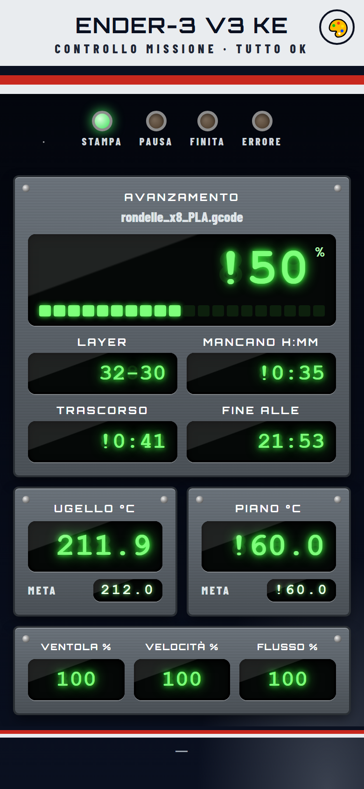

# Ender KE Status

Uno schermino da telefono per seguire una **Creality Ender-3 V3 KE** (firmware originale Creality): avanzamento, layer, tempo mancante, ora di fine, temperature di ugello e piano, ventola, velocità e flusso.

*A tiny phone-friendly status page for the Creality Ender-3 V3 KE (stock firmware). It reads the printer's websocket on port 9999 and shows progress, temperatures and ETA. Seven retro themes, including one that catches fire as the nozzle heats up. Italian UI.*

<p align="center">
  
  
  
  
</p>
<p align="center">
  
  
  
</p>

## Temi

Le cifre sono display a 7 segmenti, come i vecchi contatori. Il pulsante 🎨 in alto cambia sfondo, e la pagina ricorda l'ultimo scelto:

| Tema | Stile |
|---|---|
| `pompa` | Pompa di benzina anni '80: insegna rossa a strisce, piastre d'acciaio, cifre arancioni |
| `arcade` | Sala giochi 1986: griglia al neon fucsia, cifre azzurre |
| `terminale` | Terminale 1982: fosfori verdi e righe del monitor |
| `radio` | Radio della nonna: legno, ottone, display verde acqua |
| `jukebox` | Juke-box anni '50: pavimento a scacchi, rosa e menta, cifre rosse |
| `luna` | Missione Luna 1969: pannelli grigi tra le stelle, cifre verdi |
| `rovente` | 🔥 Ugello rovente: segue la temperatura vera dell'ugello. Fredda è blu ghiaccio, mentre scalda diventa arancio e poi rossa, alla temperatura di stampa compaiono le fiamme animate dal basso. Quando la stampa finisce si raffredda insieme alla stampante. |

Si può anche aprire direttamente un tema: `http://IP-DEL-PC/?tema=arcade`.

Per vedere il tema `rovente` a stampante spenta si può forzare la temperatura: `http://IP-DEL-PC/?tema=rovente&caldo=210`.

## Come funziona

```
telefono ──http──▶ PC (server.py) ──websocket :9999──▶ stampante
```

La stampante con il firmware originale manda lo stato su un websocket (`ws://IP:9999`). Molti browser non permettono a una pagina di collegarsi lì direttamente, quindi un piccolo server Python sul PC:

- tiene aperta la connessione con la stampante (con heartbeat e riconnessione automatica);
- serve la pagina `index.html`;
- espone lo stato in JSON su `/status`, che la pagina interroga ogni 2 secondi.

Non serve root, Klipper esposto o Moonraker. Pagina e font sono tutti in locale: non serve internet, basta la rete di casa.

## Requisiti

- Python 3.10 o più recente
- `pip install -r requirements.txt`
- PC e telefono sulla stessa rete della stampante

## Uso

```bash
python server.py
```

- primo argomento, facoltativo: IP della stampante, oppure `auto` (predefinito): il server cerca da solo la stampante nella rete locale (porta 9999) e la ritrova se il router le cambia IP;
- secondo argomento, facoltativo: porta del server, predefinita `80`.

Poi dal telefono apri `http://IP-DEL-PC` (per esempio `http://192.168.1.14`).

### Come app sul telefono

Dal menu del browser scegli **Aggiungi a schermata Home** (Android) o **Condividi → Aggiungi alla schermata Home** (iPhone): compare l'icona col display arancione e la pagina si apre a schermo intero, senza barre del browser.

### Avvio automatico all'accensione del PC (Windows)

Doppio clic su `avvio-automatico.bat` e premi Invio (oppure scrivi l'IP della stampante, se vuoi fissarlo): il server parte subito e poi a ogni accensione, senza finestre aperte, e scrive i messaggi in `server.log`. Senza IP cerca da solo la stampante nella rete. Installa da solo le dipendenze.

Per toglierlo:

```
powershell -ExecutionPolicy Bypass -File avvio-automatico.ps1 -Rimuovi
```

Su Linux si può usare un servizio systemd con `ExecStart=/usr/bin/python3 /percorso/server.py 192.168.1.12 8080`.

### Avvisi a fine stampa

- **Con la pagina aperta:** quando la stampa finisce il telefono suona e vibra (tre note allegre), se va in errore suona un allarme. Il browser permette il suono solo dopo che hai toccato la pagina almeno una volta. Il titolo della scheda mostra la percentuale.
- **Anche a schermo spento:** installa l'app gratuita [ntfy](https://ntfy.sh) sul telefono, iscriviti a un argomento con un nome difficile da indovinare (es. `ender-mario-7f3k`) e avvia il server con:

  ```bash
  python server.py --ntfy ender-mario-7f3k
  ```

  Arriva una notifica quando la stampa inizia, va in pausa, finisce (con la durata), viene annullata o va in errore. Con l'avvio automatico: `avvio-automatico.bat -Ntfy ender-mario-7f3k`. Chi conosce il nome dell'argomento può leggere le notifiche, per questo conviene sceglierne uno lungo e casuale.

## Problemi comuni

- **Dal telefono non si apre ma dal PC sì:** prova la porta 80 (quella predefinita). Con porte come 8000 alcuni telefoni/browser non si collegavano.
- **Windows chiede il permesso del firewall:** consenti a Python l'accesso alla rete privata.
- **"stampante non raggiungibile":** la stampante è spenta, oppure il server è stato avviato con un IP fisso che è cambiato (DHCP). Con `auto` la ritrova da solo; altrimenti riavvialo con il nuovo IP o fissa l'IP della stampante nel router.
- **Su Linux la porta 80 richiede permessi:** usa una porta sopra 1024, per esempio `python server.py 192.168.1.12 8080`.

## Il numero del layer

Con i G-code di OrcaSlicer (e probabilmente di altri slicer diversi da Creality Print) il firmware non trova l'altezza layer e calcola il layer come **Z ÷ 0,1 mm**: con layer da 0,2 mm il numero va al doppio, e a metà stampa supera già il totale (es. "36 di 30"). Il totale dei layer invece lo legge giusto.

La pagina se ne accorge (il numero della stampante coincide con Z × 10, oppure supera il totale) e in quel caso stima il layer dall'avanzamento sul totale. Con stampe dove ogni layer ha più o meno lo stesso lavoro la stima è precisa; con forme molto irregolari può sbagliare di qualche layer.

## Campi usati

Dal websocket della stampante: `state`, `printFileName`, `printProgress`, `printJobTime`, `printLeftTime`, `layer`, `TotalLayer`, `nozzleTemp`, `targetNozzleTemp`, `bedTemp0`, `targetBedTemp0`, `modelFanPct`, `curFeedratePct`, `curFlowratePct`, `err`. Sono i nomi usati dal firmware Creality, non documentati ufficialmente: dovrebbe funzionare anche su altre stampanti Creality con lo stesso firmware (K1, K1C, K1 Max), ma l'ho provato solo sulla Ender-3 V3 KE.

## Licenza

MIT
